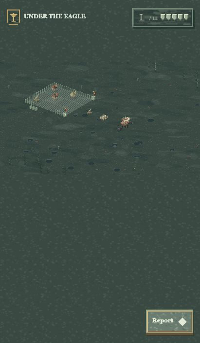

# Under the Eagle · Cold Iron v0.10

[Play online](https://ipoklay.github.io/eagle-standard-demo/)

A cold, war-torn isometric legion strategy demo with an English interface. Deep green terrain, steel-grey mud, scorched woodland, fires, blood stains and fallen soldiers. World soldiers, buildings and catapults are 70% of their previous size; controls retain their size.

Choose a card → build → MARCH. Infantry forms the front, archers the middle, catapults the rear. All squads fight on one shared battlefield. Buildings stay fixed. Pause or change speed during battle; M toggles audio.

Download index.html to play offline. Audio credits are included in the source archive.

## Source and design documents

- [Source archive](eagle-standard-demo-source.zip) — HTML, CSS, JavaScript, audio, 26 tests and packaging scripts.
- [Initial design](123.pdf)
- [Image prompt handbook](鹰旗之下-完整图像Prompt手册.pdf)
- Original roguelike.docx preserved.
