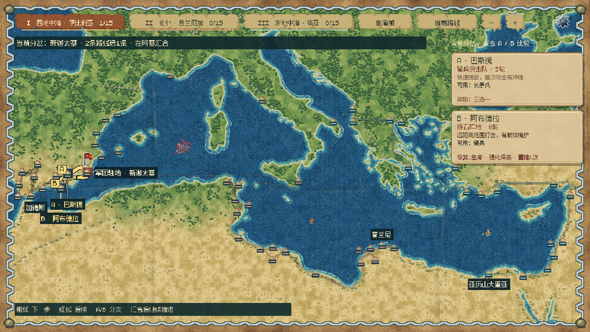
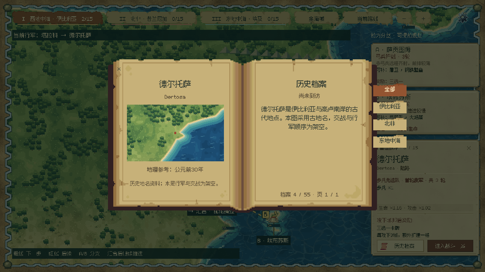
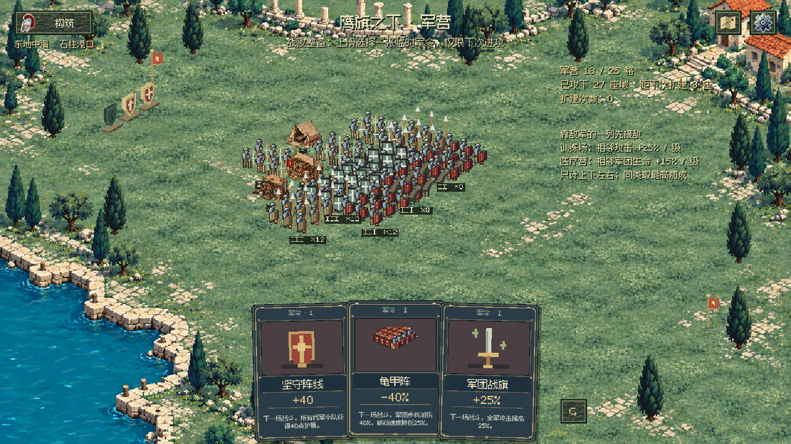

# Under the Eagle · 鹰旗之下

## 当前开发版：Godot 原生工程

当前开发以 [godot-game/](godot-game/) 为准。在 Godot 4.7.2 中导入 `godot-game/project.godot`，按 F5 运行。

- 一局远征地中海：三大战区、城邦分支、敌军情报与多轮战斗。
- 从步兵和 3×3 军营开始，通过战后选牌、建筑相邻协同与外围扩建构筑军团。
- 安全节点自动存档；战败后整备与一次性临时军令；精英奖励强化保底与一次重抽。
- 二维像素战场、地图海面与行军动效、纸张 UI、书页动画，以及中英双语、音量和帧率设置。
- 本仓库保存工程源文件、所需素材、授权说明、配置、设计文档及测试脚本。Godot 导入缓存、玩家存档和临时测试产物不入库。

运行与历史更新见 [工程说明](godot-game/README.md)，数值与数据归属见 [DATA_GUIDE](godot-game/DATA_GUIDE.md)。目前仍是开发原型，平衡性持续测试中；本次同步源码未重新导出试玩安装包。

## 最新游戏画面

以下为当前 Godot 开发原型的游戏截图。

### 地中海远征地图

沿城邦分支选择下一站，对比敌军、战斗轮数与奖励，规划本局远征。

### 城邦历史档案

以像素书页查看古地名与地理资料；地理参考公元前 30 年，行军与交战为架空设计。

### 军营与战败整备

在石柱港口战区调整军团，查看建筑相邻协同，并选择仅作用于下次进攻的临时军令。

## 旧网页试玩版 v0.14

下面的公开试玩链接与网页源码档案保留原版本；上传 Godot 源码不会自动部署网页版。

[直接试玩 / Play online](https://ipoklay.github.io/eagle-standard-demo/)

A full-screen isometric legion strategy game with 24 cards, seven troop types and endless yearly battles. Use the gear button to choose **中文 / English**, adjust sound and war-cry volume, or toggle impact feedback. Settings pause the battle and are saved locally.

## Growing threats

Years 1–3 are gentle infantry patrols. Enemy archers arrive in year 4, shield guards in year 6, cavalry in year 8 and catapults in year 10. Health and attack increase gradually every year; enemy squad count grows every other year to a cap of 20. The year label includes a compact preview of the enemy composition before battle.

## Build your legion

Every year offers three random cards, avoiding consecutive repeats whenever possible and filtering capped upgrades. Buildings remain fixed; troops automatically form a shared battlefield. Combine Fire Arrows + Pitch Stones, Spearmen + Pin & Pierce, Shields + Medics, Cavalry + Blood & Glory, and melee engagement + Crossfire. BUILD lists your army and synergies.

Choose a card → build or upgrade → MARCH. Start with three lives; one failed year costs one life. Pause, speed up battle, or press M to toggle sound. Download index.html to play offline. Campaign progress is not saved after reloading.

49 automated checks cover combat, yearly progression, localization, random draws and synergies. The starting army can survive the first three years without supplies. A fixed seven-squad army loses in year 16 without doctrines, and wins with the tested combined build. This is an initial balance pass for further playtesting.

## Source and private design documents

- [Source archive](eagle-standard-demo-source.zip) — current HTML/CSS/JS, assets, 49 checks, balance probe and packaging scripts.
- [Initial design](123.pdf)
- [Image prompt handbook](鹰旗之下-完整图像Prompt手册.pdf)
- Original roguelike.docx preserved. Audio credits are included in the archive.

The public play link requires no repository invitation. Source collaboration requires access to this private repository; GitHub App authorization is a separate permission.
