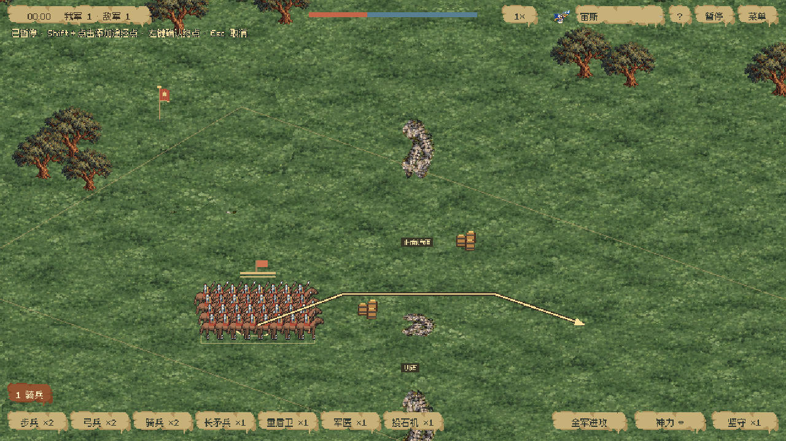
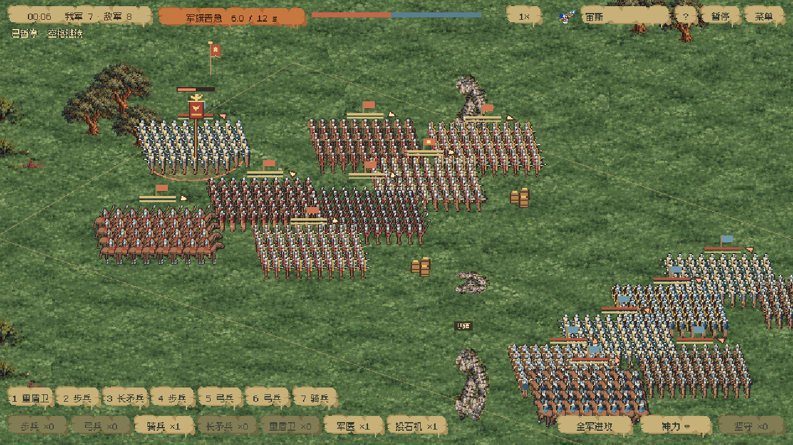
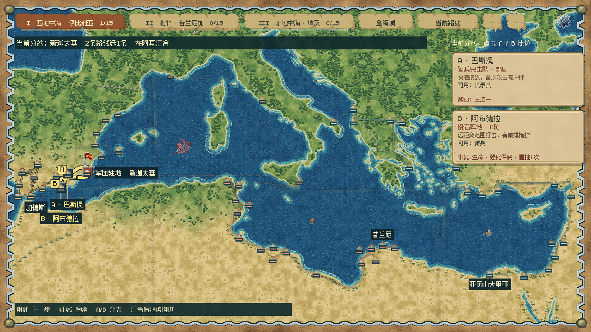
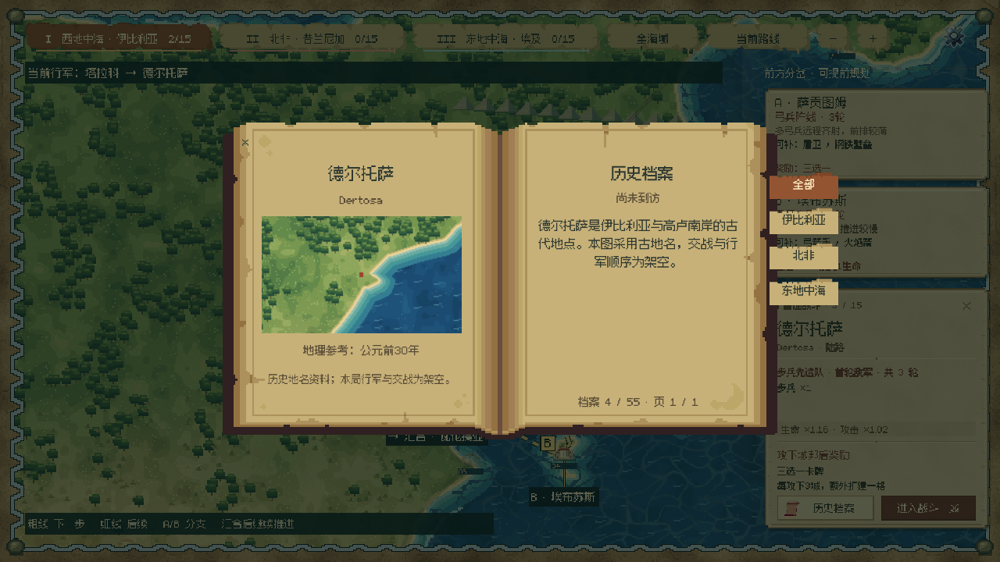
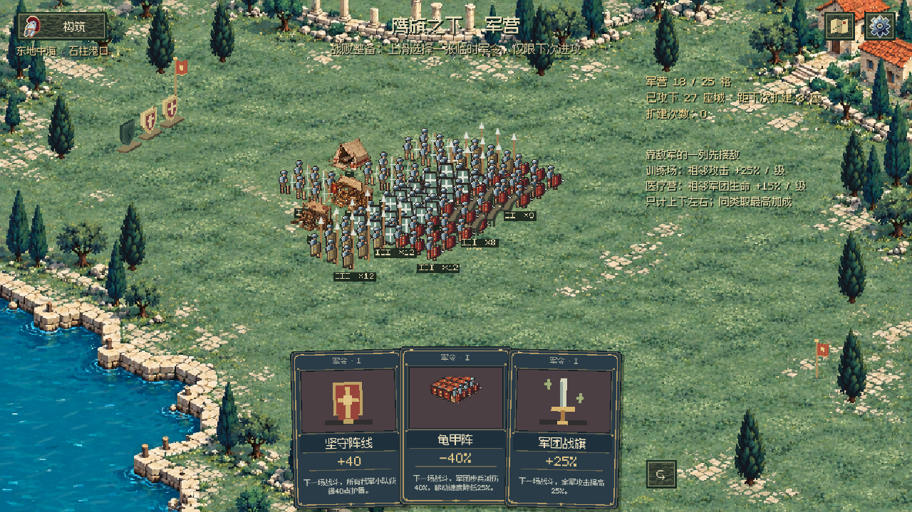

# Under the Eagle · 鹰旗之下

## 当前开发版：Godot 原生工程

**历史交接（2026-11-07）：** [2026-11-07 战斗核心与完整剩余任务](handoff/combat-core-2026-11-07/README.md)。该记录描述当时的范围和遗留问题，不代表当前版本的验收结论。

编译后的试玩包、录像和旧工程副本已从当前版本移出，模型源文件与游戏所需资源保留。历史截图、日志和旧网页资料见[归档索引](docs/archive/README.md)。旧历史仍含大文件，新协作者可使用浅克隆，只下载当前版本。

```sh
git clone --depth 1 git@github.com:IpoKlay/9kings.git
```

后续试玩包使用 GitHub Releases 分发。本次清理尚未迁移到 Releases，已有历史包可从对应 `builds/` 说明中的历史链接按需获取。

当前开发以 [godot-game/](godot-game/) 为准。在 Godot 4.7.2 中导入 `godot-game/project.godot`，按 F5 运行。

- 从主菜单进入「军团会战 · RTS」，默认开放野战；七个部署类别可切换旧公开版32种配置，也可选择山口守阵或攻城演练。山口保留守旗/夺旗规则，攻城目前完成石墙五击破坏。
- 血条旁的短三角标出方阵正面。盾兵坚守时锁定朝向，骑兵从侧后方冲入可削弱敌军士气。
- 选中方阵后，Shift 点击地面添加路点，普通点击确定终点。山口行军按阵宽绕岩，后队在窄口等候，正面接敌时可改道。
- 一局远征地中海：三大战区、城邦分支、敌军情报与多轮战斗。
- 从步兵和 3×3 军营开始，通过战后选牌、建筑相邻协同与外围扩建构筑军团。
- 安全节点自动存档；战败后整备与一次性临时军令；精英奖励强化保底与一次重抽。
- 二维像素战场、地图海面与行军动效、纸张 UI、书页动画，以及中英双语、音量和帧率设置。
- 本仓库保存工程源文件、所需素材、授权说明、配置、设计文档及测试脚本。Godot 导入缓存、玩家存档和临时测试产物不入库。

运行与历史更新见 [工程说明](godot-game/README.md)，数值与数据归属见 [DATA_GUIDE](godot-game/DATA_GUIDE.md)。山口地形与行军的验收记录见 [RTS 开发进度](godot-game/docs/RTS_PROGRESS.md)。

## 2026-11-05 原生工程同步

主工程保持单排编队，包含山口进攻计划、预备队、战后复盘、萨贡图姆远征战斗，以及骑兵冲击和各兵种反馈。三个正式布局现在可直接在 Godot 2D 编辑器修改并保存。

- [会战 HUD](godot-game/scenes/ui/battle_hud.tscn) · [编辑器与实机对照](https://github.com/IpoKlay/9kings/blob/81b5e7492ac5bdbec6b7b89fff64eab383624554/output/editable-scenes/comparison-hud.png)
- [山口布局](godot-game/scenes/battlefields/roman_pass.tscn) · [编辑器与实机对照](https://github.com/IpoKlay/9kings/blob/81b5e7492ac5bdbec6b7b89fff64eab383624554/output/editable-scenes/comparison-pass.png)
- [主菜单](godot-game/scenes/ui/main_menu.tscn) · [编辑器与实机对照](https://github.com/IpoKlay/9kings/blob/81b5e7492ac5bdbec6b7b89fff64eab383624554/output/editable-scenes/comparison-menu.png)
- [六排冲锋独立源码](https://github.com/IpoKlay/9kings/blob/1f82ba2ad4b3ec802d9ba066dca6617a44e5d75a/output/formation-impact/%E5%85%AD%E6%8E%92Godot%E5%B7%A5%E7%A8%8B/project.godot) · [冲击验收与录像](https://github.com/IpoKlay/9kings/blob/81b5e7492ac5bdbec6b7b89fff64eab383624554/output/formation-impact/%E8%AF%95%E7%8E%A9%E4%B8%8E%E9%AA%8C%E6%94%B6.md)
- [同步范围与复测说明](docs/SYNC-2026-11-05.md)

按钮位置、纸签样式、树木、军旗、阻挡岩壁、出生标记与菜单行距的具体编辑入口见 [DATA_GUIDE](godot-game/DATA_GUIDE.md)。六排源码属于历史验收快照，链接指向清理前的提交；当前开发使用单排主工程。

## 历史功能截图

以下保留原生原型的历史功能截图，用于说明玩法；不代表最新美术或当前验收结果。

### 山口会战





### 地中海远征地图

沿城邦分支选择下一站，对比敌军、战斗轮数与奖励，规划本局远征。



### 城邦历史档案

以像素书页查看古地名与地理资料；地理参考公元前 30 年，行军与交战为架空设计。



### 军营与战败整备

在石柱港口战区调整军团，查看建筑相邻协同，并选择仅作用于下次进攻的临时军令。



## 历史资料与美术源文件

- [历史产物归档与恢复索引](docs/archive/README.md)：旧截图、测试日志、旧网页源码及逐文件校验清单。
- [可编辑美术源文件](art-source/README.md)：保留的 Blender 模型和生成脚本。
- [初始设计](123.pdf)、[图像 Prompt 手册](鹰旗之下-完整图像Prompt手册.pdf)、[原始 roguelike 文档](roguelike.docx)：历史设计资料，保留备查。

当前开发与运行仅使用 Godot 原生工程；旧网页试玩档案不再作为开发入口。
