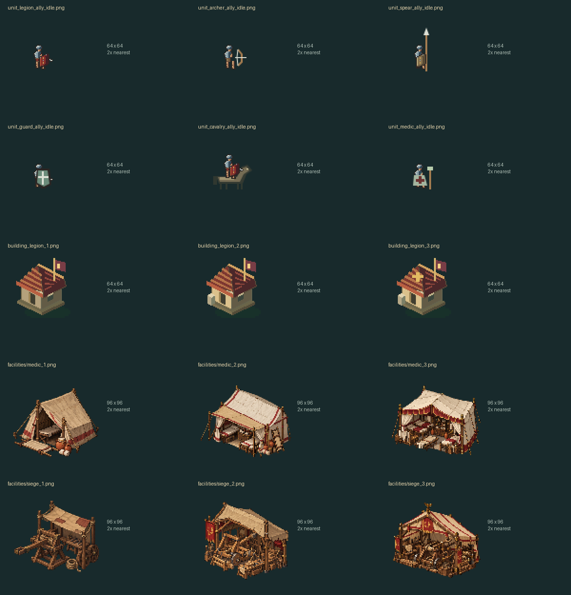
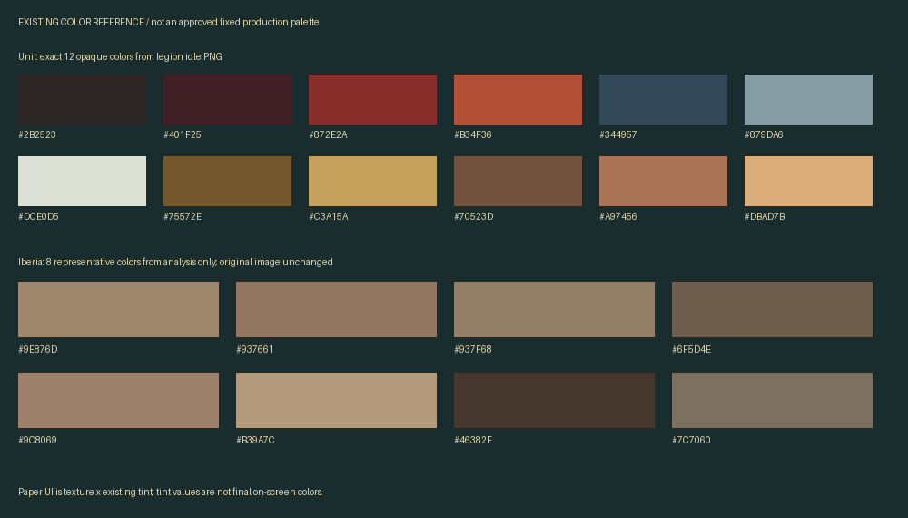
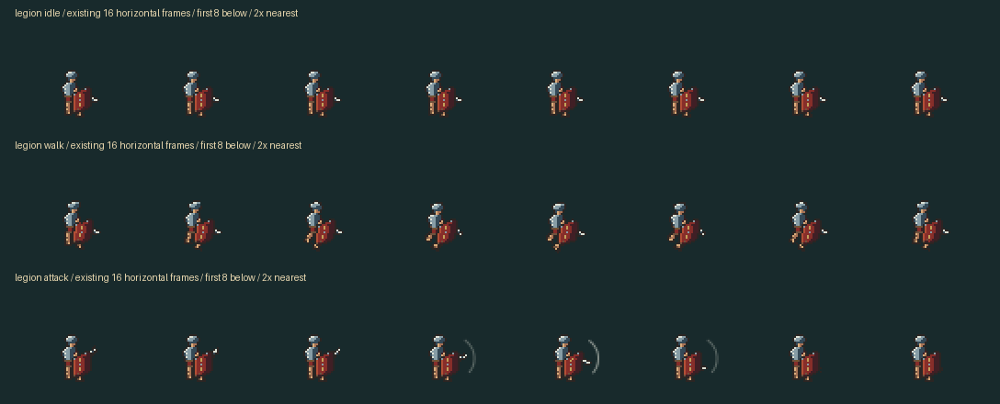
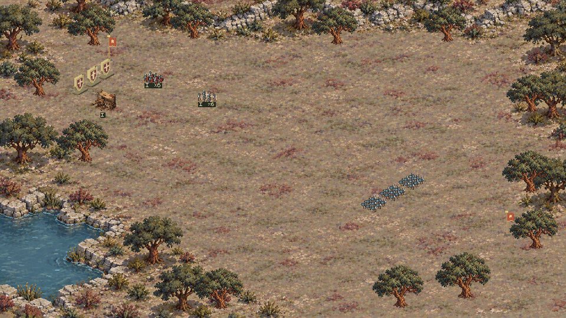
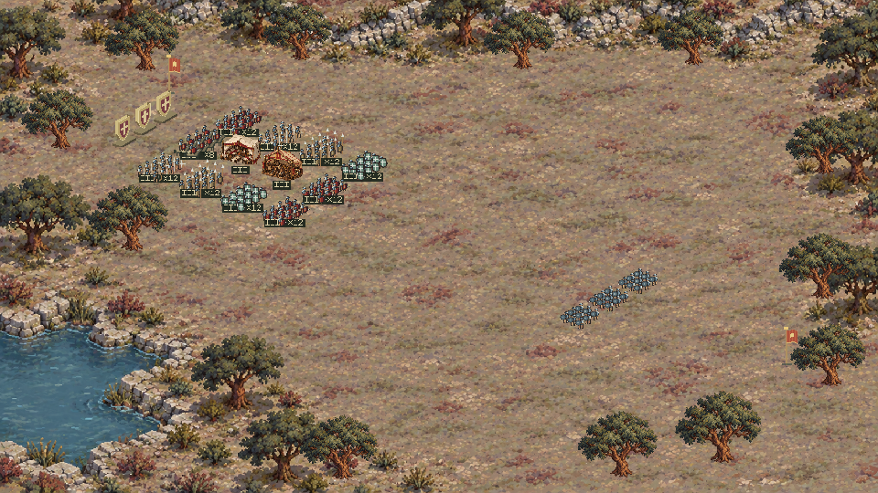
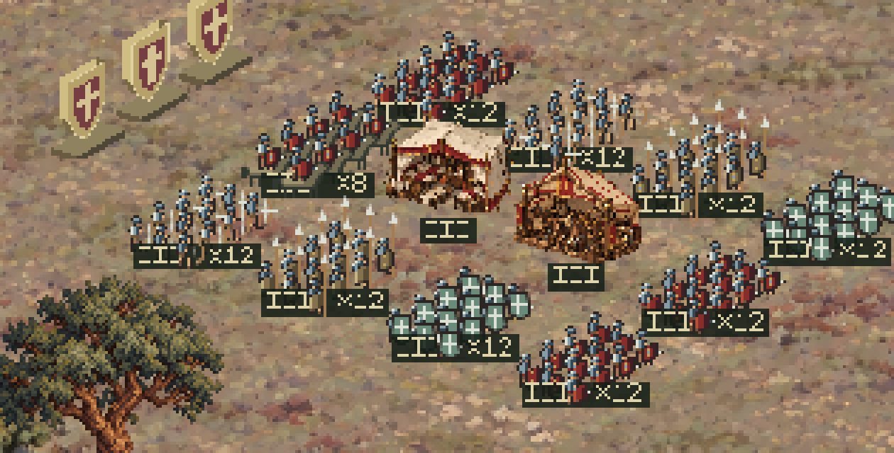

# 《鹰旗之下》罗马边境军营 · Style Bible

版本：1.0 · 首件试制规范  
日期：2026-10-27  
状态：第一阶段完成；六项咨询结果已记录。允许按P01制作首件样本，样本通过后才能批量生产。本文不是已完成关卡的交付声明。

## 1. 本次已经确认的方向

| 状态 | 规范 | 依据与适用范围 |
|---|---|---|
| 已确认 | 使用当前 Godot 原生工程 | `project.godot`；不使用网页或 WebView |
| 已确认 | 第一版为独立可玩关卡，验证选中、移动和简单交互，再接入远征 | 用户本轮选择；不替换当前12格部署军营 |
| 已确认 | 地中海岩丘灌木环境 | 用户本轮选择；延续当前伊比利亚战场方向 |
| 已确认 | 新军营优先整数倍显示，窗口不适配时留边 | 用户本轮选择；不改现有菜单、远征和战斗的显示方式 |
| 已确认 | 新军营沿用当前斜视角，默认2倍整数镜头 | 用户本轮选择；人物、建筑、地形整体放大 |
| 已确认 | 可控士兵补四个斜向的站立、行走和交互动画 | 用户本轮选择；需要制作，当前资源尚不具备 |
| 已确认 | 真正的二维像素画风，保留现有配色方向 | 硬边像素、清楚轮廓；避免模糊缩放、拟3D、柔软弹性变形 |
| 已确认 | 保留现有玩法、美术和交互成果 | 当前人物比例、地形、卡牌上滑、纸张UI、书本、海面和声音均为兼容基线 |
| 已确认 | 按P01推荐规格试制，样本确认后再批量制作 | 用户本轮选择；准确色板与细节密度在首件审阅后冻结 |
| 已确认 | 未明确的规格先咨询 | “当前实现”与“建议”不得自动变成已批准规范 |

视觉一句话：**在现有伊比利亚岩丘灌木环境里，建立一个能看清道路、建筑入口和士兵行动的罗马边境军营；红色军旗与暖金提示作为视觉焦点。** 新布局尚未制作。

历史范围沿用项目既有古罗马背景；这不是考古复原认证。本轮未开展建筑形制、军服年代与军营布局的史料核验；不能用现有素材外观代替历史依据。

## 2. 规范状态与优先级

1. **已确认**：用户明确批准，后续代理必须遵守。
2. **现有实现**：从当前工程和资源读取的事实，保留兼容；不表示全库已统一或已通过新规格。
3. **已准予试制**：P01可用于首件样本；样本尚未通过，不能直接批量生产。
4. **建议／待确认**：未涵盖在本轮选择中的交互、布局和史料细节继续提案。
5. **历史提案**：保留追溯，不参与当前规格覆盖。

用户最新确认优先于本文建议。新资源规范只适用于新军营；不得为了“统一”而回写、重采样或重新导入现有全部素材。JSON清单中 `sample_ready=true` 表示可试制，`production_ready=false` 表示尚未获准批量生产。

## 3. 当前工程的尺寸与视角基线

| 层级 | 实际值 | 含义 |
|---|---|---|
| 应用逻辑画面 | 1920×1080 | 菜单、UI和战场布局使用的逻辑坐标 |
| 默认窗口 | 1280×720 | 逻辑画面并非按整数倍显示 |
| 战场渲染缓冲 | 960×540 | 世界节点缩为0.5倍绘制，再铺到1920×1080 |
| 远征地图世界 | 5760×2520 | 可拖动地图的坐标范围，与军营地块无关 |
| 远征底图 | 2880×1260 | 与地图世界尺寸分开记录 |
| 当前部署区 | 4×3格，中心间距120×126 | 玩法布局，不是Tile Size |
| 当前纹理采样 | 最近邻，不使用mipmap | 可避免插值模糊；不自动保证物理像素块等宽 |

来源：[project.godot](../../project.godot)、[main.gd](../../scripts/main.gd)、[contracts.json](../../data/schema/contracts.json)、[field.tres](../../data/presentation/field.tres)。

现有镜头是二维斜投影。忽略平移量后：屏幕x＝0.76×世界x−0.68×世界y；屏幕y＝0.27×世界x＋0.40×世界y。它不是标准2:1等距。建筑和士兵按落地点屏幕y排序。新素材不能套用另一套标准等距模板后宣称视角一致。

**当前没有统一地形Tile Size，也没有在现有场景中使用TileMap／TileSet。** 三张战场背景都是完整图片。地形拼接和可行走占地需要为新关卡另行建立。

## 4. 新军营参数包 P01（已确认用于首件试制）

用户已选择按推荐规格试制。以下作为首件样本的制作参数；分辨率、拼块／步兵画布、建筑分体量、左上光、1像素描边和现有取色方向已有试制授权。精确色板、建筑脚点、动画节奏等细节需随样本审阅，不能声称已经过视觉验收。

| 项目 | 推荐值 | 理由与约束 |
|---|---|---|
| 世界渲染缓冲 | 960×540 | 与当前战场实际渲染尺寸兼容，便于对照 |
| 新关卡UI坐标 | 960×540 | 与新关卡缓冲对应；既有1920×1080 UI不迁移 |
| 显示倍率 | 1×、2×、3×…最近邻 | 居中留边，不允许1.333×等非整数倍率；小于960×540时限制窗口最小尺寸，不静默缩小 |
| 默认镜头 | 已确认 D04：2×整数镜头 | 只在新军营将地形、建筑和单位一起放大，便于选择；不单独放大士兵 |
| 首版地图范围 | 960×540基础像素的场景画布 | 2×镜头可见480×270，允许平移；无需先做巨大军营 |
| 地形模块／Tile Size | 32×32基础像素 | 用于地表图片模块与纹理密度；不是32×16等距菱形，也不是碰撞格或部署格 |
| 地形转接 | 草土、土石各有边缘与角部变体 | 避免直切生态边界；模块制作在现有斜视角下表达地表，不改变投影 |
| 新步兵帧 | 32×32基础像素；脚点(16,26) | 对应现有64×64逻辑画布及(32,52)脚点的一半；先做单个样本验证，不能自动将旧图批量缩小 |
| 新步兵本体 | 约11×13基础像素，参考现有军团兵 | 这是当前战场体量参考，不包含长矛、旗杆；近镜头再整体放大 |
| 骑兵 | 先记录独立身体范围和双足接地点 | 不强塞进步兵可见身高；首版无需增加骑兵操作范围 |
| 建筑帧 | 按体量登记，首批48×48或64×64基础像素 | 48×48对应当前96×96设施在战场缓冲中的范围；不把所有建筑缩成同一个大小 |
| 树木／灌木 | 灌木16×16或32×32；树可用80×90上限参考 | 所有尺寸用基础像素，树根为脚点；先验比例后批量制作 |
| 描边 | 新资源通常1基础像素，深棕而非纯黑 | 小内部结构可用色块代替描边；轮廓不一律加粗 |
| 光源 | 新资源固定左上受光、阴影向右下 | 烘焙为有限色阶；不新增3D灯光或连续高光 |
| 透明度 | 新主体RGBA透明底，主体轮廓alpha为0或255 | 地面影子独立层；如需半透明，登记独立材质例外，不在主体边缘加柔边 |
| 新资源颜色 | 从现有素材取色，每种材质3–5级明暗 | 不强行采用历史32色色板；首件试制批准后再冻结准确色号和例外 |

32×32指**图片模块尺寸**。道路是否可走、墙体能否穿越、建筑入口在哪，使用独立占地／导航数据；不能从图片画布或透明边缘直接猜测。沿用斜投影时，逻辑正方格的投影轮廓与32×32图片外框不是一回事。

显示示例：采用960×540基础缓冲时，1280×720窗口显示960×540并居中留边；1920×1080窗口显示2倍。内部2×镜头与窗口2×显示相乘，世界美术每个基础像素对应4×4物理像素。UI可保持自己的1倍基础网格，不跟随世界镜头缩放。

## 5. 实际资源清单与复用边界

本轮扫描 `assets/` 下209张PNG；完整尺寸、颜色、alpha和SHA256见 [asset-inventory.csv](evidence/asset-inventory.csv)。数量不包含字体、声音、图集切片和导入缓存。

| 类别 | 当前资源 | 新军营的用途与限制 |
|---|---|---|
| 罗马单位 | 84张1024×64 PNG；7类×敌我2套×6状态 | 保留造型、盾牌、服色和动作参考；每帧64×64，左右镜像，不具备四／八向 |
| 旧建筑 | 24张64×64 | 比例与屋面表达参考；不是可进入建筑、围墙连接件或导航资源 |
| 医疗／攻城设施 | 6张96×96；各三级 | 保留现有版本，作为军营设施参考；细节与alpha需在新关卡单独验收 |
| 投石机 | 1280×80，16个80×80帧 | 攻击动作可参考；没有多向行走素材 |
| 战场背景 | 伊比利亚1671×941；北非与东岸各1672×941 | 伊比利亚是当前环境方向基准；整图不能充当已完成的模块地形 |
| 旧树木 | 22张160×180 | 历史独立树形参考，不是当前风动树的实际取图来源 |
| 当前环境树源 | `environments/oak.png` 1254×1254；`environments/trees.png` 2172×724 | 当前风动从这组图片取样，由代码处理；不是现成逐帧表 |
| 罗马图标 | 6张，通常32×32，齿轮30×32 | 复用设置、头盔、军旗、卷轴、桂冠；保留已有柔化白描边的着色处理 |
| 纸张UI | `ui_rpg/ui.png`，984×640 | 复用小提示、任务纸签；图集切片与色调由现有UI预设管理 |
| 字体 | m5x7-eagle、Fusion Pixel中文、Monogram回退 | 复用当前字体链；新字号需要中英文实际排版检查 |
| 声音 | 当前原生音乐／音效资源 | 后续复用设置、静音与总音量，不另起一套播放配置 |

现有资源对照，均为原图裁帧后2倍最近邻展示，不是新关卡效果图：



**缺口**：模块化营门、栅栏／围墙直段与转角、角塔、道路与地表过渡、入口与阻挡数据、自由移动的方向动画、可编辑动画源与运行时表的完整对应关系。

## 6. 比例、锚点与朝向

当前军团兵64×64帧内，idle有效像素约21×26；脚底锚点(32,52)。骑兵有效范围约41×37。画布大小不能当作身体大小，也不能当作碰撞范围。

| 资源 | 当前源帧 | 当前绘制／锚点 | 对新资源的约束 |
|---|---|---|---|
| 士兵 | 64×64 | 64×64逻辑尺寸，脚点(32,52) | 保留人体、盾牌比例；新关卡缩放须整体一致 |
| 医疗／攻城营 | 96×96 | 96×96，脚点(48,82) | 门口与视觉脚点分开记录 |
| 旧建筑分支 | 64×64 | 74.2×74.2，偏移(37.1,63.7) | 兼容现状，不能复制成新资源整数像素标准 |
| 投石机 | 80×80 | 73×73，偏移(40,65) | 同上，实际显示存在非整数资源比例 |
| 树木 | 尺寸不同 | 底部中心定位 | 摆动固定树根，不能整棵平移 |

建议每个新资源记录：源画布、帧宽高、有效像素范围、视觉脚点、排序脚点、阻挡多边形、入口／交互点。视觉与导航数据独立；源稿可包含不导出的脚点标记层。

**已确认 D05：移动朝向。** 新关卡可控军团兵补四个斜向的站立、行走和交互动画；按移动向量选择最近朝向，停止时保留朝向。四向仍有近似，需在八个移动方向检查滑步和翻转跳变。左右两向仅是现有资源状态，不能代替本轮确认的四向交付。当前16帧动作表不能代替新方向资源。

## 7. 色彩与材质

已确认的是**延续现有配色方向**，没有已批准的全项目固定32色限制。

军团兵idle原图可直接提取的12个不透明色：

| 用途参考 | 实际色号 |
|---|---|
| 深描边 | `#2B2523` |
| 暗红与红色亮面 | `#401F25`、`#872E2A`、`#B34F36` |
| 钢铁 | `#344957`、`#879DA6`、`#DCE0D5` |
| 铜金 | `#75572E`、`#C3A15A` |
| 木／皮色 | `#70523D` |
| 肤色 | `#A97456`、`#DBAD7B` |

这12色只描述这张idle表。其他动作、背景与设施含更多颜色，不能把整库称为12色或32色资源。



图中伊比利亚8色是对原整图的统计归纳，主要代表占比大的土石色；不覆盖少量绿色、水蓝、军旗红等焦点颜色。分析取色没有改动原PNG。新资源建议以深绿植被、灰褐岩面、土褐路径、灰黄布料、暗红军旗和少量暖金构成，不用高饱和色铺满环境。

材质建议：岩面使用大明暗块与少量裂缝；木材保留纵向纹理与端面；布料保留折线与补丁；金属用窄亮边，不画连续镜面反光；地表纹理对比低于单位轮廓。每种材质3–5色阶是新资源建议，不是当前背景已经符合的事实。

纸张UI的最终颜色＝原图×现有着色参数。`ui.tres` 中paper tint为(0.92,0.84,0.69)，这不是最终屏幕纸色。罗马UI原图白描边也经着色器适配，不应直接把原白色抽进新面板。

## 8. 动画规则（当前事实与新建议分列）

当前事实：idle固定第0帧；walk约0.483秒一循环、读取16个索引；attack窗口0.48秒。军团兵walk只有9个不同像素帧、attack有15个。不要将代码中的`clock*13`解释为13 FPS。当前死亡旋转、部分图像alpha和条带树风动是兼容现状，不自动成为新资源标准。



P01建议：新可控军团兵idle 4帧、6 FPS；walk 8帧、12 FPS；交互4–6帧、8 FPS。保持落脚点稳定，不通过整体缩放模拟呼吸。攻击不属于首版简单交互的必要动作，现有战斗攻击节奏不修改。每条动画标注循环与结束姿态，帧率与玩家30／60／120／无限制设置独立。

P01建议：旗帜6帧、8 FPS；灌木和树梢4–6帧、6 FPS；根部固定，基础像素位移1–2，较大树冠上限3。不同实例使用稳定的不同相位；风向空间上协调，强弱与延迟不同。不要随机到每棵树同时向相反方向剧烈摆动。以上幅度只用于新军营试制，不能改写现有树木风参数。

若军营含水，继承当前深色二维水面方向，不新造立体水；是否需要水池尚非首版必需项。静态地面预绘制，环境动画仅在姿态变化时更新；避免为了数株灌木每帧重建整幅地图。

## 9. 场景构图与UI建议

建议首版只做可识别的入口、主路、营房区、训练空地和一处补给点。岩丘与较高树木放在边缘，灌木在营外稀疏分布；道路与建筑脚点服从同一斜投影。首版确切布局属于第二阶段，不在本轮擅自定死。

建议入口在屏幕下方可见区域；主要移动通道避免被树冠遮住。单位选中用暖金、硬边、贴地的轮廓标记，建筑入口用小旗或纸签提示，颜色之外配合图形变化。选中效果不使用霓虹光晕。

建议只保留小型单位信息、操作提示和返回入口；沿用纸张／暗红主行动视觉，不增加占据半屏的大面板。点击热区可大于画面符号，但应有悬停反馈。现有卡牌上滑规则不变；独立关卡的选中、移动键位与简单交互将在第二阶段提出接口。

建议简单交互为“选中军团兵 → 移动到补给点 → 完成一次领取反馈”；这仍是待批准的玩法选项，不是已有功能。第一阶段未向游戏中增加此操作。

## 10. 源稿、导出、命名与目录建议

以下为P01的一部分，已准予用于首件试制；批量生产须等样本通过。保留当前资源名称，不能批量改名已有`unit_*`、旧camelCase卡片ID或导入路径。

| 交付项 | 推荐规范 |
|---|---|
| 可编辑源稿 | Aseprite `.aseprite`，分层保留轮廓、主体、阴影与不导出的脚点／占地参考 |
| 导出图片 | PNG RGBA；背景图可用RGB；无JPEG、无导出时插值缩放 |
| Sprite Sheet | 每个动作／方向一张横排表，固定帧画布；不自动裁切每帧透明边缘 |
| 元数据 | 同名JSON记录`frame_size`、`frame_count`、`fps`、`loop`、`pivot_px`、`direction`、源文件和校验值 |
| 导入 | 最近邻、无mipmap；是否启用透明边缘修正单独核查，不将编辑器预览当最终渲染结果 |
| 坐标命名 | 图片尺寸和锚点统一以基础像素`_px`记录；时间用`_seconds`，帧率用`_fps` |
| 文件命名 | snake_case；如`camp_legion_walk_se.png`、`camp_gate_wood_01.png`、`camp_ground_dirt_01.png` |
| 方向标识 | `ne/se/sw/nw`明确表示屏幕斜向；不得与阵营`ally/enemy`混用 |
| 来源记录 | 每组素材附SOURCE，记录制作来源、原包路径、源稿与导出对应；许可结论以已读取文本为准 |

建议目录（本轮仅创建文档目录，其余未建立）：

```text
godot-game/docs/roman_frontier_camp/       本规范、决策与证据
art-source/roman_frontier_camp/           新Aseprite源稿、色板、导出清单
godot-game/assets/roman_frontier_camp/    地形、建筑、单位、装饰、UI PNG
godot-game/scenes/roman_frontier_camp/    独立关卡与实体场景
godot-game/scripts/roman_frontier_camp/   对应原生逻辑
godot-game/data/presentation/            已确认的表现参数.tres
godot-game/data/roman_frontier_camp/      地图、资源占地、动画元数据JSON
```

文档中的参数JSON是规范状态清单，不是生产运行配置。后续需要表现参数时沿用当前数据分层；不让JSON和`.tres`同时维护一份可修改数值。玩家设置仍由现有设置系统管理，新关卡测试状态与玩家远征存档隔离。

## 11. 来源与历史方案

- `tools/import_web_assets.cjs`已禁用，不得运行旧网页导入器。当前单位表的历史源链包含分层像素数据与动作烘焙；84张表尚无完整的一一对应Aseprite动画源。
- `output/battle-v4/U01-master.aseprite`等是1帧32×32历史母版，不是当前完整动画。旧0.7缩放及(16,28)脚点不能覆盖当前1.0、(32,52)逻辑脚点。
- `output/art-direction-native-v1/ART-BIBLE.md`明确标注“待确认、未接入”；旧32色、左上光、地表32／64模块均为历史建议。即使本轮建议数值相似，也需要本轮明确确认。
- 六张新设施的原图与提示词在`output/legions-v1/source-art/`及`art-prompts.json`；现有制作工具执行最近邻缩到96×96，没有统一限色或二值alpha验收。
- 旧AncientRome外部路径当前不存在；工程内6张图标及License保留。Pixel RPG源记录提到Aseprite／PSD，但源记录未提供许可全文；Humble ZIP含License.pdf，本轮未核验条款。不得写成已完成商用许可审查。
- 现有工程更新记录包含2026-10-27主菜单清理及2026-10-26声音、军团三级、卡牌、卷轴和滚轮修复；这些更新均属于保留基线。

## 12. 本轮证据、问题与后续验收

已执行：两个独立只读盘点；209张PNG统计；代表素材原图与动作裁帧检查；在Godot 4.7.2、Compatibility／Apple M4上渲染现有战场；保留960×540原图与4倍最近邻局部。





第二张图是在独立内存状态中放置12个III级部署项的审查夹具，仍使用现有战场、单位与设施；**它不是新军营地图，也没有验证新的自由选中移动。** 截图不含原菜单UI；未写玩家存档，未测性能或重新导出试玩包。



具体问题见 [REVIEW_AND_DECISIONS.md](REVIEW_AND_DECISIONS.md)。后续硬性验收建议：

- 原图、源稿、帧表与元数据互相对应；帧数、画布、脚点自动检查。
- 新关卡1×／2×显示逐像素一致；禁用线性过滤；相机平移不能让轮廓出现插值模糊。
- 地形接缝、建筑入口与阻挡、士兵脚点和前后遮挡在实际Godot运行中检查。
- 单位向八个方向移动、经过建筑后方、停止和再次转向均需录制，不用静态图代替功能检查。
- 密集场景检查可选中性、遮挡、旗树动画相位与帧时间；不预先宣称120FPS已通过。
- 新输入、设置和退出不改变已有远征、卡牌或声音功能；生产改动后再运行相关回归测试。

下一步：第二阶段制定地图、单位、游戏逻辑与UI四项任务的接口和验收，并安排首件试制。先验证一个四向军团兵、一个营房与一组地面转接的共同场景样本；用户审阅后冻结准确色板、比例与动画，再批量生产。该样本组合是下一阶段的推荐执行顺序，本轮未启动资源制作或新关卡实现。
