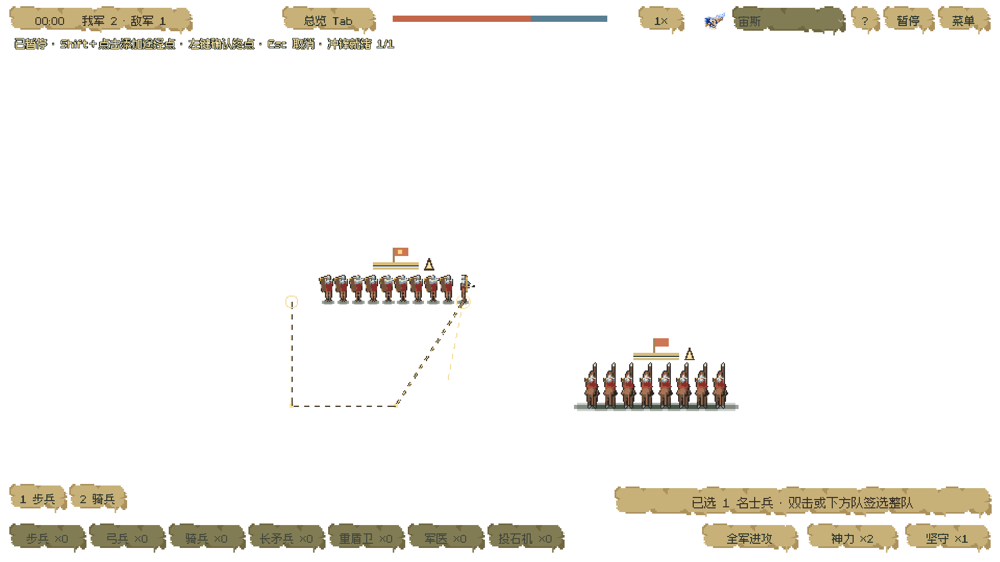
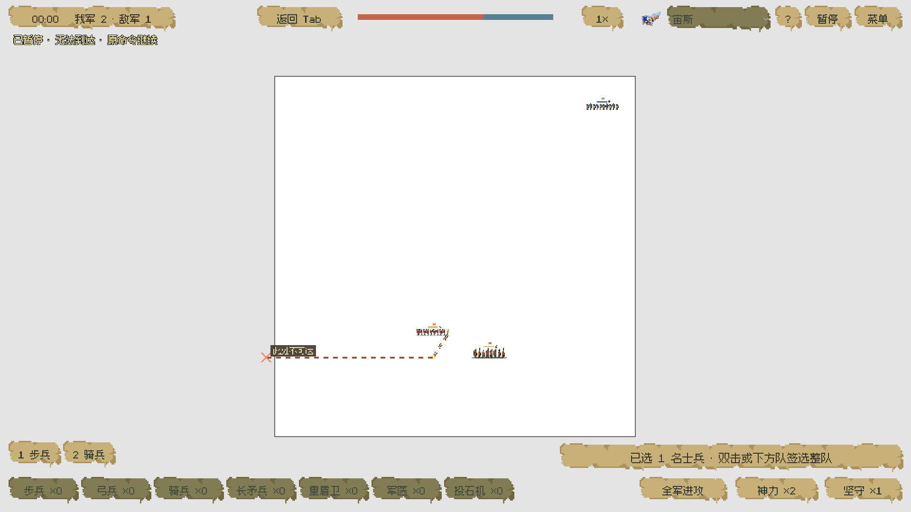

# 白板指挥闭环 · 2026-11-07

本轮完成常规兵力下的路点规划修复与指挥回归。没有继续千人优化；完整战斗复现目标仍未完成。

试玩入口：`godot-game/project.godot` → 运行主场景 → 军团会战 → 七兵种布阵 → 开战。生产改动只有 `scripts/tactical/trial.gd` 与 `trial_field.gd`，其他为测试、只读观测和交接记录。

## 修复

- 单兵或多名士兵选择后，Shift 路点现在使用实际发令逻辑的只读校验：越界、岩石占位、选择中的某人不能抵达，都拒绝加入路线。已有有效路点与正在执行的命令保留。
- 失败提示在暂停和其他瞄准模式下仍可读；有效修正会清除旧错误。单兵与整队都显示路点操作提示。
- 个人路线预览增加墨色底线，无效落点显示红叉与“此处不可达”。标记保持屏幕尺寸，Tab 全览也可辨认。预览线表示玩家指定的途经点，障碍间实际绕行仍由既有寻路决定。

## 验证

| 项目 | 结果 | 证据 |
|---|---|---|
| 修复前真实窗口复现 | 24项中6项失败：无效草稿、错误隐藏、错误未清除、岩石路点 | `before-visible.log`、`before-checks.json`、`before-*.png` |
| 修复后输入专项 | 真实窗口27项全部通过，另加英文与多选边界检查 | `after-visible.log`、`after-checks.json` |
| 攻击移动、盾墙、途中改令 | 25项通过 | `after-battle-commands.log` |
| 冲锋输入 | 16项通过 | `after-charge.log` |
| 旧方形地图输入 | 0失败 | `after-square-input.log` |
| 默认七兵种完整会战 | 26项通过；30/60/120帧率输入终局状态一致，42.5167模拟秒胜利，我方15存活 | `after-full-battle.log`、`full-battle.json` |

输入专项从真实主菜单按钮进入，经预设部署、开战和暂停，随后使用三队隔离夹具验证路径：单人经过两个转角、终点落脚、未选邻兵不动、Esc取消草稿、岩石/越界拒绝、多选边界校验、整队双击、骑兵途中替换路线、H停在当前位置、重试清理。窗口中的输入由Godot InputEvent注入；不是人工玩家验收。截图直接读取Godot帧缓冲。

`before-routes.log` 为早期测试夹具读取未分离士兵position的错误，已修测试并完成有效窗口基线；`before-live.*` 是MCP鼠标桥未携带Shift的无效复现，不能作为缺陷证据。有效修复前证据以 `before-visible.log` 为准。

## 正常实时会战

另从编辑器正常运行主菜单，通过鼠标桥点击部署、开战、全军进攻，中键移镜后保持1×镜头与正常速度。只读观察器不调用step、不改变兵力、伤害或结算。

- 双方各57人，共14队、114人。
- 自然胜利，现实40.696秒 / 模拟40.700秒，我方15人存活。
- 平均实际渲染107.06 FPS，P95帧间隔12.5 ms。当前机器Apple M4、Godot 4.7.2、约1278×718窗口；包含截图读回，不能外推到千人或其他机器。
- 真人即时点击时刻与固定步回归不同，因此40.700秒和42.5167秒是两次不同输入流程，不能据此声称逐帧一致。
- 点击“重新布阵”后：部署状态、0我方/7敌方、1×镜头；选择、草稿、尸体、箭、石弹、效果全部清空，暂停关闭。见 `live-retry.json`。
- 实时流程为静音；运行中临时切换app语言字段导致部分静态英文按钮保留，该截图不用于语言切换验收。完整中文输入专项截图在下面。

证据：`live-battle.json`、`live-8s.png`、`live-20s.png`、`live-result.png`、`live-retry.json`。观察器为 `tests/tactical/observe_live_battle.gd`，仅测试时附加，没有接入正式启动流程。

## 画面





## 复现命令

从项目根目录执行：

```sh
/Users/ip/Downloads/Godot.app/Contents/MacOS/Godot --path godot-game --resolution 1920x1080 --position 0,0 --always-on-top --script tests/tactical/test_command_route_input.gd
/Users/ip/Downloads/Godot.app/Contents/MacOS/Godot --headless --path godot-game --script tests/tactical/test_battle_commands.gd
/Users/ip/Downloads/Godot.app/Contents/MacOS/Godot --headless --path godot-game --script tests/tactical/test_charge_input.gd
/Users/ip/Downloads/Godot.app/Contents/MacOS/Godot --headless --path godot-game --script tests/tactical/test_individual_full_battle.gd
```

## 边界与下一项

先前API选敌缓存的7个源文件/测试哈希全部保留，详见 `validation.json`。本轮没有修改兵数、美术、伤害、冲锋参数、寻路算法或默认相机比例。

部分无窗口测试仍报告既有ObjectDB/资源退出警告，不能称整个工程零错误。本轮没有验证全部山口/存档、原作新版一致性、声音或跨平台导出，也没有推送GitHub或更新旧试玩包。

下一核心项：在当前白板上做侧击步兵、正冲盾墙、正冲坚守长矛的同条件正常速度对照，量化首次接触、每骑停点、阵线缺口与恢复。当前只证明指挥闭环与本机终局；不把旧版与新版原作、单排与多排结论混用，不预设单排长矛必须绝对拦停。
